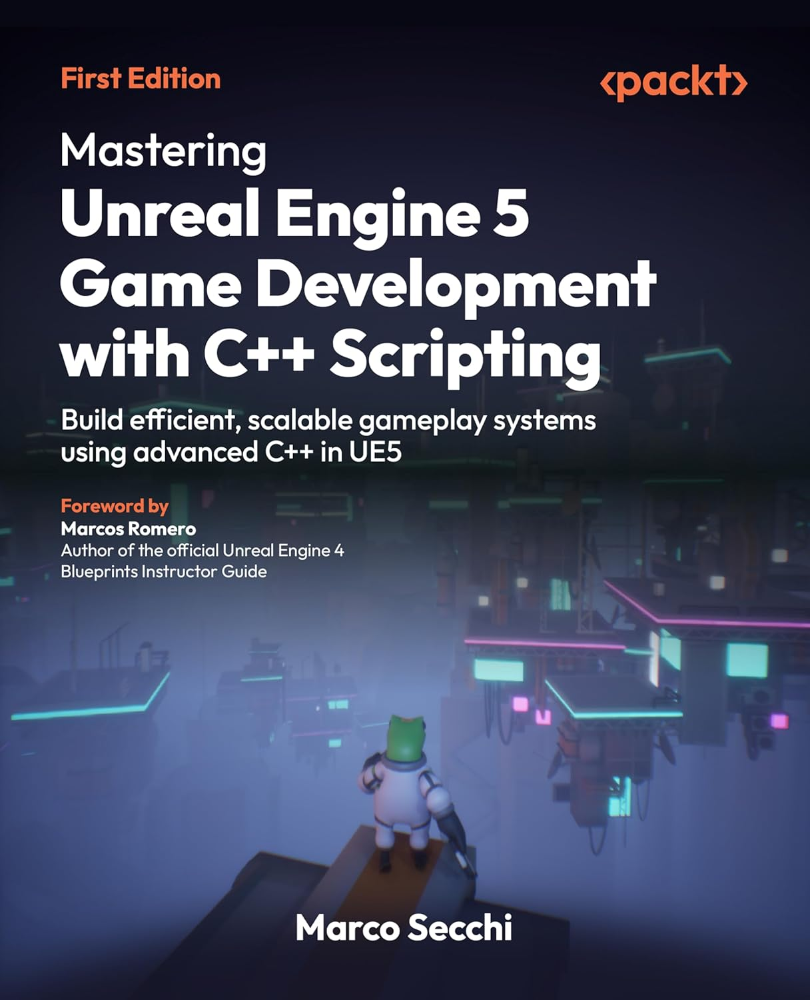
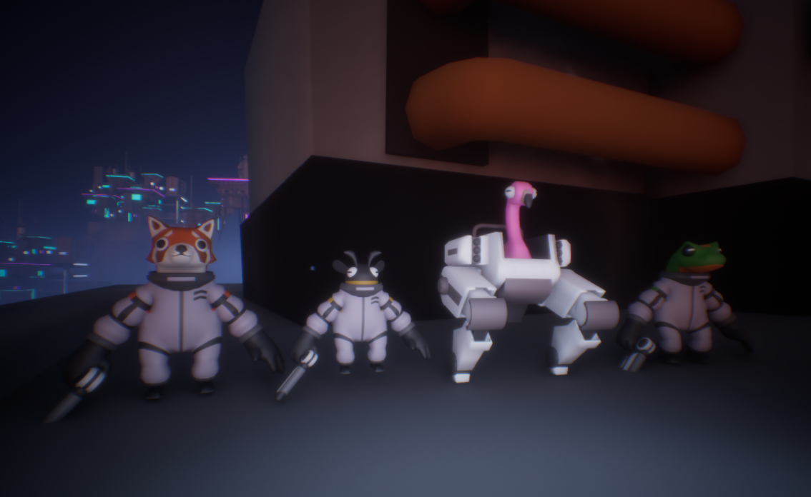
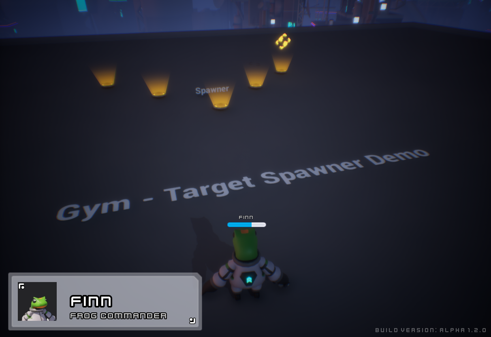

# Paws in the Shell - The OmniSight Conspiracy

## Companion project for _Mastering Unreal Engine 5 Game Development with C++ Scripting_

Unreal Engine version: 5.8

The book is available on Amazon: https://www.amazon.com/Mastering-Unreal-Engine-Development-Scripting-ebook/dp/B0FM47XR59/

## Gameplay Feedbacks Plugin

Since _version 1.3.0_ the project is using the **Gameplay Feedbacks Plugin**, which is [available on FAB](https://fab.com/s/ddc5a2bb118f).

_Note: for more information on Gameplay Feedbacks, please visit the official documentation available here:[https://marcosecchi.github.io/gameplayfeedbacks_docs/](https://marcosecchi.github.io/gameplayfeedbacks_docs/#/)_

## Credits

* **Ultimate Space Kit** and **Cyberpunk Game Kit** assets by [Quaternius](https://quaternius.com/)
* **UI Pack - Sci-Fi** by [Kenney](https://kenney.nl/)
* Additional 3D models by [The Base Mesh](https://www.thebasemesh.com/)
* Animated icons by [Flaticon](https://www.flaticon.com/)

